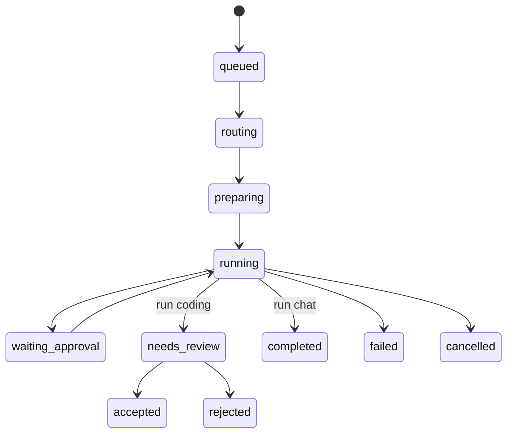

# API & Event Contract — Personal AI OS

Semua klien memakai satu REST API `/v1` dan satu WebSocket `/v1/ws`. Skema didefinisikan sekali di `packages/contracts` (Zod) lalu dipakai gateway, desktop, worker, dan menjadi OpenAPI untuk Android.

## Konvensi

- ID memakai UUIDv7. Waktu disimpan UTC (`timestamptz`), zona waktu jadwal default `Asia/Jakarta`.
- Error memakai format RFC 9457: `{ type, title, status, detail, code }`.
- Pagination berbasis kursor: `?before=<id>&limit=50`.
- Auth: header `Authorization: Bearer <access_token>`. Access token 15 menit, refresh token per perangkat 90 hari, bisa dicabut.

## Endpoint REST

| Area        | Endpoint                                                                          | Fungsi                                                                                                                                                                                                                                                                                                                                                                    |
| ----------- | --------------------------------------------------------------------------------- | ------------------------------------------------------------------------------------------------------------------------------------------------------------------------------------------------------------------------------------------------------------------------------------------------------------------------------------------------------------------------- |
| Auth        | `POST /auth/login`                                                                | Password + TOTP, mendaftarkan perangkat, mengembalikan token                                                                                                                                                                                                                                                                                                              |
| Auth        | `POST /auth/refresh`, `POST /auth/logout`                                         | Perbarui atau cabut token perangkat                                                                                                                                                                                                                                                                                                                                       |
| Perangkat   | `GET /devices`, `DELETE /devices/:id`, `POST /devices/:id/push-token`             | Kelola perangkat dan token FCM                                                                                                                                                                                                                                                                                                                                            |
| Perangkat   | `POST /devices/worker`                                                            | Desktop mendaftarkan worker sidecar (scope `app`); mengembalikan perangkat `worker` dan tokennya, worker lama bernama sama dicabut                                                                                                                                                                                                                                        |
| Model       | `GET /models`, `GET /quota`                                                       | Daftar model dan combo dari 9Router, pemakaian dan kuota                                                                                                                                                                                                                                                                                                                  |
| Role        | `GET /roles`, `POST /route/preview`                                               | Daftar role, uji router tanpa menjalankan agent                                                                                                                                                                                                                                                                                                                           |
| Percakapan  | `GET/POST /conversations`, `PATCH/DELETE /conversations/:id`                      | Daftar, buat, ubah judul, arsipkan                                                                                                                                                                                                                                                                                                                                        |
| Pesan       | `GET /conversations/:id/messages`, `POST /conversations/:id/messages`             | Riwayat; kirim pesan sekaligus memulai run                                                                                                                                                                                                                                                                                                                                |
| Pesan       | `POST /messages/:id/reroute`                                                      | Ganti role lalu jalankan ulang, dicatat sebagai koreksi                                                                                                                                                                                                                                                                                                                   |
| Pesan       | `POST /messages/:id/edit`, `DELETE /messages/:id`                                 | Potong percakapan dari pesan itu (pesan itu dan semua sesudahnya dibuang). `edit` (hanya pesan pengguna) lalu mengirim teks baru seperti `POST /conversations/:id/messages`. Sesi Hermes diganti; giliran berikutnya mengirim riwayat yang tersisa sebagai konteks, sehingga agent tidak mengingat bagian yang dibuang. `409 run_in_progress` bila jawaban masih berjalan |
| Run         | `GET /runs/:id`, `GET /runs/:id/events?afterSeq=`                                 | Status dan putar ulang event                                                                                                                                                                                                                                                                                                                                              |
| Run         | `POST /runs/:id/steer`, `POST /runs/:id/cancel`                                   | Arahkan atau hentikan agent                                                                                                                                                                                                                                                                                                                                               |
| Run         | `POST /runs/:id/approvals/:approvalId`                                            | `{ decision: allow \| deny, remember }`                                                                                                                                                                                                                                                                                                                                   |
| Run         | `POST /runs/:id/review`                                                           | `{ decision: accept \| reject, comments[], merge?, commitMessage? }`; hasil `{ run, branch, commit, merged, mergeSkipped, revisionRunId }`. `accept` = satu commit di branch `aios/…` (opsional fast-forward ke branch kerja); `reject` = buang; `reject` dengan `comments` = run baru di worktree yang sama (`revisionRunId`)                                            |
| Project     | `GET/POST /projects`, `PATCH /projects/:id`                                       | Project terdaftar per worker (path tetap lokal)                                                                                                                                                                                                                                                                                                                           |
| Kanban      | `GET /projects/:id/tasks`, `POST /tasks`, `PATCH /tasks/:id`                      | Kartu, status, urutan, role. `PATCH` dengan `status`/`position` memindahkan kartu; urutan kedua kolom dirapikan server. Hanya Backlog, Todo, dan Done yang bisa dituju; Running dan Review diisi sistem                                                                                                                                                                   |
| Kanban      | `POST /tasks/:id/run`, `POST /tasks/breakdown`                                    | Kerjakan kartu (run coding; mengembalikan kartu: `runId` terisi bila dimulai, `null` bila mengantre karena slot project penuh); AI memecah ide jadi usulan kartu (belum disimpan)                                                                                                                                                                                         |
| Jadwal | `GET/POST /schedules`, `PATCH/DELETE /schedules/:id` | Kelola jadwal. Target `briefing` merangkum riset selesai, kartu di Review, dan hasil jadwal lain dalam 24 jam terakhir ditambah topik di prompt. `notify: on_change` (bukan untuk `research`) mengirim hasil run sebelumnya sebagai konteks; bila agent menyatakan tidak ada perubahan, run tetap `succeeded` dengan `changed: false` dan tanpa push |
| Jadwal      | `POST /schedules/parse`, `POST /schedules/:id/run-now`, `GET /schedules/:id/runs` | Bahasa alami ke cron, jalankan sekarang, riwayat                                                                                                                                                                                                                                                                                                                          |
| Riset       | `POST /research`, `GET /research`, `GET /research/:id`                            | Buat dan pantau job riset                                                                                                                                                                                                                                                                                                                                                 |
| Riset       | `POST /research/:id/cancel`, `GET /research/:id/export?format=md\|pdf`            | Batalkan, ekspor                                                                                                                                                                                                                                                                                                                                                          |
| Berkas      | `POST /files`                                                                     | Unggah lampiran (maks 25 MB)                                                                                                                                                                                                                                                                                                                                              |
| Memori      | `GET/POST /memories`, `PATCH/DELETE /memories/:id`                                | Fakta tentang pemilik (maks 500 karakter, maks 200 memori; `409 memory_limit` bila penuh). Memori aktif disuntik ke pesan sistem setiap run chat dan coding, terlama dulu; yang nonaktif tetap tersimpan                                                                                                                                                                  |
| Ruang | `GET/POST /spaces`, `PATCH/DELETE /spaces/:id`, `GET/POST /spaces/:id/documents`, `DELETE /spaces/:id/documents/:documentId` | Ruang pengetahuan: berkas dari `POST /files` (PDF, DOCX, teks) diekstrak, dipotong per bagian, dan diindeks full-text. Percakapan dengan `spaceId` (`POST /conversations`) menyertakan potongan paling relevan sebagai konteks tiap giliran dan agent menyebut sumbernya. `GET /conversations?spaceId=` menyaring percakapan ruang. Maks 50 dokumen per ruang (`409 space_full`) |
| Model       | `POST /compare`                                                                   | `{ prompt, models[2..3] }` → `{ results[{ model, ok, text, latencyMs, usage, error }] }`; paralel lewat 9Router tanpa streaming, satu model gagal tidak menggagalkan yang lain, tidak membuat percakapan atau run                                                                                                                                                         |
| Proxy model | `/llm/v1/*`                                                                       | Diteruskan ke 9Router, hanya token ber-scope `llm`                                                                                                                                                                                                                                                                                                                        |
| Kesehatan   | `GET /healthz`, `GET /readyz`                                                     | Cek layanan dan dependensi (tanpa auth, untuk pemantau)                                                                                                                                                                                                                                                                                                                   |
| Kesehatan   | `GET /status`                                                                     | Halaman Status (scope `app`): versi gateway dan adapter, dependensi, worker terdaftar dan statusnya, antrean job, run berjalan                                                                                                                                                                                                                                            |

## WebSocket

Klien membuka `/v1/ws`, lalu berlangganan channel: `user` (notifikasi umum), `conversation:<id>`, `run:<id>`. Saat berlangganan, klien mengirim `lastSeq` agar event yang terlewat diputar ulang.

```json
{ "type": "subscribe", "channel": "run:0192f0c4-...", "lastSeq": 41 }
```

Setiap event dari server dibungkus envelope yang sama:

```json
{
  "v": 1,
  "channel": "run:0192f0c4-...",
  "seq": 42,
  "ts": "2026-10-22T06:38:00Z",
  "event": { "type": "message.delta", "messageId": "...", "text": "..." }
}
```

## Tipe AgentEvent

| Event                                          | Isi                                                          | Dipakai untuk               |
| ---------------------------------------------- | ------------------------------------------------------------ | --------------------------- |
| `run.status`                                   | `status`                                                     | Indikator status            |
| `route.decided`                                | `role, confidence, reason`                                   | Chip role                   |
| `message.delta`, `message.completed`           | Potongan teks; usage token                                   | Streaming jawaban           |
| `reasoning.delta`                              | Potongan penalaran (opsional)                                | Blok terlipat               |
| `tool.started`, `tool.output`, `tool.finished` | Nama, target, potongan output, status, durasi                | Baris langkah tool          |
| `approval.requested`, `approval.resolved`      | Jenis (command, file_write, network), detail, cwd; keputusan | Panel izin                  |
| `diff.updated`                                 | Daftar file dengan tambah dan hapus                          | Panel diff, diff stat kartu |
| `checkpoint.created`                           | ID dan label                                                 | Undo                        |
| `preview.ready`                                | URL dev server                                               | Panel preview               |
| `research.progress`, `research.source`         | Tahap dan progres; sumber baru                               | Layar riset                 |
| `error`                                        | `code, message, retryable`                                   | Pesan error                 |
| `run.completed`                                | Ringkasan, usage                                             | Penutup run                 |

Channel `user` membawa: `task.updated`, `schedule.result`, `research.completed`, `notification`.

## Kartu kanban

Kartu mengikuti run terbarunya: run berjalan = **Running**, `needs_review` = **Review**, `accepted` = **Done**, `failed`/`cancelled`/`rejected` = kembali ke **Todo** (kegagalan juga memicu `notification` level error). Tolak dengan komentar membuat run revisi, jadi kartu tetap Running. Kartu antre = status `running` dengan `runId` null; dimulai sendiri saat slot kosong (batas `TASK_MAX_PARALLEL`, default 2 per project). Kartu dengan run aktif tidak bisa dipindah (409 `task_running`); kartu antre boleh dikeluarkan. Setiap run kartu berjalan di worktree dan branch sendiri (`aios/<id>`), jadi run paralel tidak saling mengganggu.

## Protokol worker

- Worker membuka WebSocket ke gateway di `/v1/worker/ws` dengan token ber-scope `worker` (header `Authorization` saat handshake). Satu koneksi aktif per perangkat; koneksi baru menggantikan yang lama. Gateway hanya menerima `run.event` untuk run milik project yang terdaftar atas perangkat itu.
- Perintah dari gateway: `run.start` (runId, projectId, prompt, bundel role dan skill, model, `continueFromRunId` untuk revisi), `run.steer`, `run.cancel`, `approval.resolve`, `review.apply` (dijawab worker dengan frame `review.result`; gateway menunggu maksimal 30 detik, dan worker menjawab perintah yang diulang dengan hasil yang sama).
- Isi diff tidak lewat gateway: aplikasi desktop membacanya dari worker lokal (`review.get`, `review.undo`, `review.revertFile`); ke gateway hanya event `diff.updated` (daftar file, tambah, hapus) dan `checkpoint.created`.
- Terminal: shell sungguhan (PTY) di worker, satu per project atau per worktree run. Desktop memakai `terminal.open` (mengembalikan id dan riwayat keluaran), `terminal.write`, `terminal.resize`, `terminal.close`; worker mendorong `terminal.data` dan `terminal.exit`. Tidak lewat gateway.
- Preview website: desktop membaca dan mengendalikannya dari worker lokal (`preview.start`, `preview.get`, `preview.stop`, `preview.shot`; worker mendorong `preview.state`). Ke gateway hanya event `preview.ready` (URL proxy lokal) selama run berjalan. Agent memakai tool browser lewat server MCP lokal worker, bukan lewat gateway.
- Worker mengirim AgentEvent ke channel `run:<id>`. Gateway menyimpan lalu menyiarkan.
- Aplikasi desktop dan worker bicara lewat WebSocket lokal di `127.0.0.1` dengan port acak dan token yang diberikan Tauri saat sidecar dijalankan. Token dipakai sekali: balasan `ready` membawa token untuk koneksi berikutnya. Koneksi yang membawa header `Origin` (halaman web) ditolak. Skema pesan lokal ada di `packages/contracts/src/worker-local.ts`.

## Status run



`queued` → `routing` → `preparing` (buat worktree) → `running`, yang bisa bolak-balik ke `waiting_approval`. Run coding berakhir di `needs_review` lalu `accepted` atau `rejected`. Run chat berakhir di `completed`. Semua run bisa berakhir `failed` atau `cancelled`.

## Model data inti

| Tabel                 | Kolom penting                                                                                                                  |
| --------------------- | ------------------------------------------------------------------------------------------------------------------------------ |
| `devices`             | id, kind (android, desktop, worker), name, token_hash, scopes, push_token, last_seen_at                                        |
| `conversations`       | id, title, surface, project_id, space_id, hermes_session_id, pinned, archived_at                                                         |
| `messages`            | id, conversation_id, author (user, assistant, system), parts (jsonb), agent_role, model, run_id                                |
| `runs`                | id, kind (chat, coding, research, schedule), engine, agent_role, model, status, conversation_id, task_id, branch, usage, error |
| `run_events`          | run_id, seq, type, payload (jsonb), ts — primary key (run_id, seq)                                                             |
| `approvals`           | id, run_id, kind, detail, status, remember, decided_at                                                                         |
| `approval_rules`      | project_id, pattern, decision                                                                                                  |
| `projects`            | id, name, worker_device_id, stack (jsonb), default_branch                                                                      |
| `tasks`               | id, project_id, title, body, status, position, agent_role, run_id, branch, diff_stat                                           |
| `schedules` | id, name, cron, timezone, prompt, target (chat, research, role, briefing), agent_role, enabled, notify (always, on_change), next_run_at |
| `schedule_runs` | id, schedule_id, run_id, status, started_at, finished_at, changed |
| `research_jobs`       | id, question, depth, status, plan (jsonb), report_md, run_id                                                                   |
| `research_sources`    | id, job_id, url, title, fetched_at, used                                                                                       |
| `files`               | id, name, mime, size, content (bytea, isi berkas; ikut backup), sha256                                                         |
| `routing_decisions`   | id, message_id, role, confidence, reason, latency_ms                                                                           |
| `routing_corrections` | id, decision_id, from_role, to_role, message_excerpt                                                                           |
| `audit_log`           | id, actor_device_id, action, target, ts                                                                                        |
| `memories`            | id, text, enabled, created_at, updated_at                                                                                      |
| `spaces` | id, name, description, created_at, updated_at |
| `space_documents` | id, space_id, file_id, name, chars, created_at |
| `space_chunks` | id, document_id, space_id, ordinal, content, tsv (tsvector `simple`, indeks GIN) |
