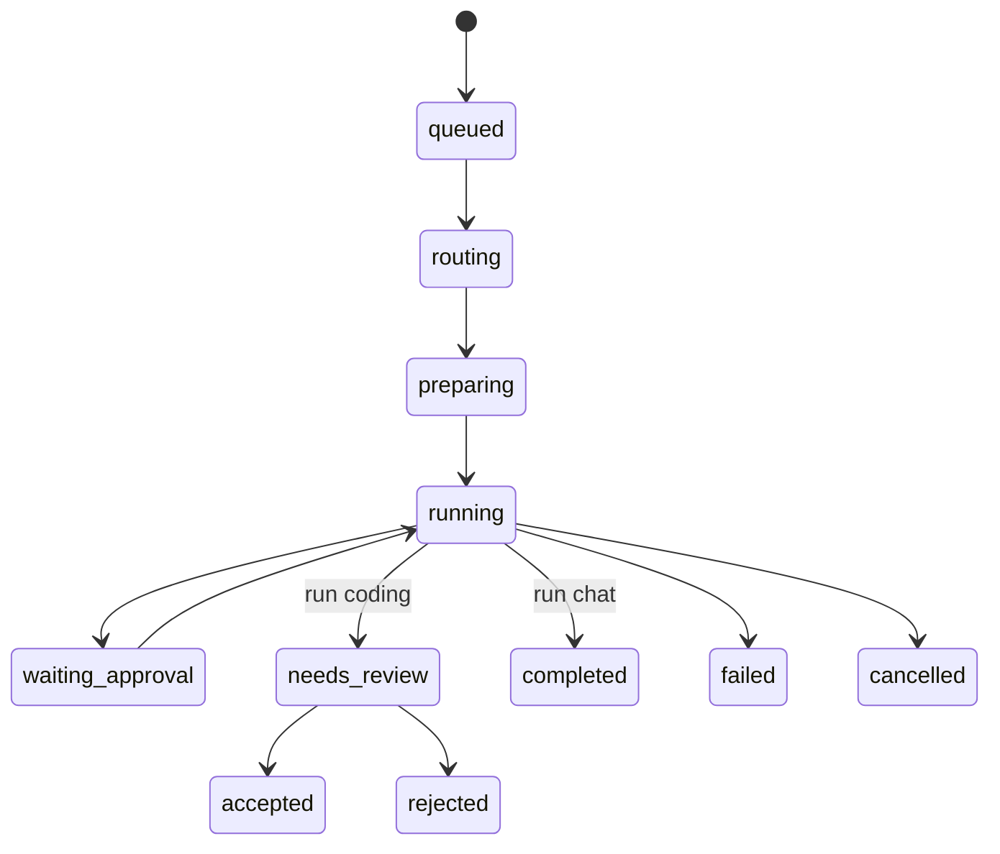

# API & Event Contract — Personal AI OS

Semua klien memakai satu REST API `/v1` dan satu WebSocket `/v1/ws`. Skema didefinisikan sekali di `packages/contracts` (Zod) lalu dipakai gateway, desktop, worker, dan menjadi OpenAPI untuk Android.

## Konvensi

- ID memakai UUIDv7. Waktu disimpan UTC (`timestamptz`), zona waktu jadwal default `Asia/Jakarta`.
- Error memakai format RFC 9457: `{ type, title, status, detail, code }`.
- Pagination berbasis kursor: `?before=<id>&limit=50`.
- Auth: header `Authorization: Bearer <access_token>`. Access token 15 menit, refresh token per perangkat 90 hari, bisa dicabut.

## Endpoint REST

| Area        | Endpoint                                                                          | Fungsi                                                                                                                                                                                                                                                                                                                                                                    |
| ----------- | --------------------------------------------------------------------------------- | ------------------------------------------------------------------------------------------------------------------------------------------------------------------------------------------------------------------------------------------------------------------------------------------------------------------------------------------------------------------------- |
| Auth        | `POST /auth/login`                                                                | Password + TOTP, mendaftarkan perangkat, mengembalikan token                                                                                                                                                                                                                                                                                                              |
| Auth        | `POST /auth/refresh`, `POST /auth/logout`                                         | Perbarui atau cabut token perangkat                                                                                                                                                                                                                                                                                                                                       |
| Perangkat   | `GET /devices`, `DELETE /devices/:id`, `POST /devices/:id/push-token`             | Kelola perangkat dan token FCM                                                                                                                                                                                                                                                                                                                                            |
| Perangkat   | `POST /devices/worker`                                                            | Desktop mendaftarkan worker sidecar (scope `app`); mengembalikan perangkat `worker` dan tokennya, worker lama bernama sama dicabut                                                                                                                                                                                                                                        |
| Model       | `GET /models`, `GET /engines`, `GET /quota`                              | Daftar model, mesin beserta kemampuannya, pemakaian dan kuota dari gateway/9Router. `GET /engines` melaporkan `hermes`, `omp`, `dsh` dengan `{ id, label, available, experimental, reason?, supportsModelPick, supportsTodo }`: Hermes lewat health check, omp lewat worker yang tersambung, dsh hanya bila `DSH_COMMAND` terisi dan proses dsh lulus jabat tangan ACP (`initialize`, hasil di-cache 30 detik). `SendMessageRequest.engine` (`hermes`, `omp`, `dsh`) memaksa mesin per pesan; tanpanya gateway memilih menurut konteks (chat umum = Hermes, project = omp). `omp` di chat umum ditolak 422 `project_required`; `dsh` di project ditolak 422 `engine_not_for_project`; `hermes` di dalam project dijawab Hermes lewat agent umum (tanpa folder project). Artifact SVG dianggap berkas, bukan gambar (`isRasterImageMime`). |
| Agent       | `GET /roles` | Daftar agent tetap (umum, project, peneliti) beserta model dan skill bawaannya; agent dipilih server dari ada tidaknya project, bukan dari klien |
| Skill       | `GET /skills`, `GET /skills/:id` | Katalog skill (P9): indeks tanpa isi (`id, name, description, version, source, checksum`) dan isi lengkap satu skill. Scope `app` ATAU `worker` (dipakai klien untuk menampilkan, dan worker untuk mengunduh isi skill yang ditawarkan ke cache dan folder skill omp miliknya; isi hanya diunduh ulang bila `checksum` berubah). Sinkron ke Hermes bukan endpoint: `pnpm skills:sync-hermes` (langkah eksplisit, lihat ROLES_AND_SKILLS.md) |
| Skill       | `POST /skills`, `POST /skills/scan`, `PATCH /skills/:id`, `DELETE /skills/:id`, `POST /skills/:id/status`, `GET /skills/:id/versions`, `POST /skills/:id/restore` | Pengelolaan katalog (P10), hanya scope `app`. `POST /skills` membuat skill buatan pengguna (`id` dari nama bila kosong; `source: user`; versi 1; deskripsi ≤200 karakter, isi ≤64 KB tanpa frontmatter). `PATCH` mengubah nama/deskripsi/isi (membuat versi baru), mesin (`engines`), `pinned`, dan `trust` (naik ke `trusted`); skill bawaan repo ditolak `409 skill_builtin`. `POST /skills/:id/status` `{ status: active\|disabled\|archived }`: skill bawaan hanya bisa dinonaktifkan (bukan diarsipkan; skill inti `409 skill_core`). `DELETE` menghapus permanen beserta riwayatnya (hanya user/installed/agent). `GET .../versions` memuat isi lengkap tiap versi (terbaru dulu, `changedBy`); `POST .../restore` `{ version }` membuat versi baru berisi isi versi lama. Semua penyimpanan dipindai (`scan`: `safe`/`warning`/`dangerous` + baris yang ditandai): `dangerous` ditolak `422 skill_scan_blocked` (skill buatan sendiri bisa lanjut dengan `acknowledge: true`; skill dari luar/agent tidak pernah), peringatan pada skill dari luar `422 skill_scan_confirm` sampai `acknowledge`. Setiap perubahan menyegarkan katalog dan, bila `HERMES_SKILLS_DIR` diisi, menyinkronkan `aios/` di folder skill Hermes (hasilnya `hermesSync: off\|ok\|failed`; gagal sinkron tidak membatalkan perubahan). `GET /skills` menerima `include=all` (hanya scope `app`) dan `engine`; tanpa itu hanya skill aktif. Field tambahan di indeks (opsional): `trust, status, engines, pinned, editable, origin, createdAt, updatedAt` |
| Skill       | `POST /skills/install/preview`, `POST /skills/install`, `GET /skills/hermes`, `POST /skills/hermes/preview`, `POST /skills/hermes/import` | Pasang dari luar dan impor dari Hermes (P10), hanya scope `app`. **Hanya gateway yang mengunduh**, klien hanya mengirim sumber: id skills.sh `pemilik/repo@skill`, URL `skills.sh/pemilik/repo/skill`, atau URL GitHub folder/`SKILL.md`. Domain yang diizinkan: `github.com`, `raw.githubusercontent.com`, `skills.sh` (https, tanpa kredensial/port lain; pengalihan keluar domain ditolak `422 skill_domain_not_allowed`). Batas: `SKILL.md` ≤64 KB, hanya teks UTF-8 (biner/jenis konten non-teks `422 skill_not_text`), waktu 10 dtk. Yang diunduh hanya `SKILL.md`; `scripts/` dan berkas eksekusi **tidak diunduh dan tidak pernah dijalankan**; bila isi merujuknya, pratinjau memberi `mentionsScripts: true`. `preview` mengembalikan isi lengkap, `scan`, `existing` (versi terpasang dengan id sama, untuk diff), `action` (`install`\|`update`\|`conflict`) dan `installable`. `install` `{ source, checksum, acknowledge? }` mengunci checksum yang dilihat pengguna (`409 skill_changed_upstream` bila sumber berubah); berbahaya `422 skill_scan_blocked` (tidak bisa dilewati), peringatan `422 skill_scan_confirm` sampai `acknowledge`; trust awal `community`. `GET /skills/hermes` mendaftar skill Hermes non-`aios-` (hanya baca): dari `GET /v1/skills` Hermes, atau dari folder `HERMES_SKILLS_DIR` bila API gagal (`via: api\|folder\|none`). `POST /skills/hermes/import` `{ name }` menyalin isinya (dari folder) sebagai skill `installed` (`origin: hermes:<nama>`) lewat pemindai yang sama. `POST /skills/hermes/preview` `{ name }` (hanya baca, tidak menyimpan) mengembalikan `candidate` (isi lengkap + `checksum` + `mentionsScripts`), `scan`, `existing`, `action`, `importable` (+ `reason`; `false` bila id bentrok atau isi membawa frontmatter kedua) dan `needsAcknowledge`. **Hanya impor Hermes** yang boleh menyetujui temuan `dangerous` dengan `acknowledge: true` (folder skill Hermes milik pemilik sendiri; klien wajib menampilkan isi dan temuan dulu); tanpa `acknowledge` tetap `422 skill_scan_blocked`, dan pasang dari luar serta skill usulan agent tetap tidak bisa dilewati |
| Skill       | `GET /skills/proposals`, `GET /skills/proposals/:id`, `POST /skills/proposals/:id/approve`, `POST /skills/proposals/:id/reject` | Usulan skill (P11), hanya scope `app`. Sumber: blok berpagar `aios-skill-proposal` di jawaban agent (JSON `{ kind: new\|patch, targetId?, name, description, body, reason }`; skill inti `propose-skill` mengajarkannya) atau skill baru buatan Hermes di folder selain `aios/` (`origin: hermes`, isi dibaca dari folder saat ditinjau). Gateway mengurai saat jawaban selesai, menyimpan usulan `pending` lewat pemindai, dan MEMBUANG semua blok dari teks yang disimpan; blok rusak tidak membuat usulan dan tidak merusak jawaban; yang berisi rahasia (kunci pribadi, token, kata sandi literal, URL berkredensial) atau frontmatter ditolak; maksimal satu usulan per jawaban dan 3 per 24 jam (sisanya dibuang dengan log); usulan `patch` hanya untuk skill tambahan yang ada (bukan bawaan repo). Daftar: tanpa query hanya `pending`, `status=all`, `conversationId`. Detail: isi lengkap, pemindai dihitung ulang, `existing` (skill aktif yang ditambal, untuk diff), `approvable`/`blockedReason`. `approve` `{ name?, description?, body?, acknowledge? }` satu-satunya jalan usulan menjadi skill (tidak pernah aktif tanpa itu): `new` menjadi skill source `agent` (aktif, langsung disinkron ke Hermes), `patch` menambal skill target (versi baru, `changedBy: agent`, sumber tetap), usulan Hermes menjalankan alur impor P10 (tanpa suntingan: `400 proposal_not_editable`). Pemindai berlaku seperti skill dari luar: berbahaya `422 skill_scan_blocked` (usulan agent tidak bisa dilewati dengan `acknowledge`, hanya dengan menyunting isinya; impor Hermes boleh), peringatan `422 skill_scan_confirm` sampai `acknowledge`. Persetujuan mengklaim usulan secara atomik (dua klik bersamaan: satu `200`, satu `409 proposal_decided`); gagal mengembalikan usulan ke `pending`. `reject` `{ reason? }`. Usulan yang sudah diputuskan: `409 proposal_decided`; target patch hilang: `409 proposal_target_missing`. Output panel Progres memuat kartu `kind: skill_proposal` |
| Skill       | `GET /skills/curator/report`, `POST /skills/curator/run` | Kurator skill (P11), hanya scope `app`. Berjalan mingguan lewat pg-boss (Senin 03:00 UTC) dan bisa dijalankan manual. Skill source `agent` yang tidak dibuka 30 hari ditandai usang (`staleSince`), 90 hari diarsipkan (bisa dipulihkan lewat `POST /skills/:id/status`, umurnya dihitung ulang); source `user` hanya ditandai; skill disematkan (`pinned`), bawaan repo, dan terpasang dari luar tidak pernah disentuh; kurator tidak pernah menghapus. Dibuka lagi menghapus tanda usang. Laporan: paling sering dibuka (7 hari), belum pernah dibuka (umur ≥7 hari), usulan menunggu, yang baru ditandai/diarsipkan, dan saran gabung (kemiripan kata deskripsi ≥0,6, tidak pernah menggabungkan). Laporan disimpan dan dikirim sebagai event `notification` dengan `topic: skill_report` |
| dsh         | `POST /conversations/:id/messages` | `engine: "dsh"` hanya untuk percakapan non-project; project mengembalikan `422 engine_not_for_project`, binary/config tidak tersedia `503 engine_unavailable`. |
| Percakapan | `GET/POST /conversations`, `GET/PATCH/DELETE /conversations/:id` | Daftar, buat, ubah judul, arsipkan. `DELETE ?permanent=true` menghapus percakapan beserta pesannya (`409 run_in_progress` bila jawaban masih berjalan) |
| Pesan       | `GET /conversations/:id/messages`, `POST /conversations/:id/messages`             | Riwayat; kirim pesan sekaligus memulai run Opsional `planOnly: true`: run coding mode rencana (agent hanya membaca dan menulis rencana; worker menolak semua izin kecuali tool web gateway yang hanya membaca; run selesai `completed` tanpa tinjauan diff). `Run.planOnly` menandainya. Opsional `webSearch: true`: gateway membuat kueri (model kecil, dari pesan dan percakapan), mencari lewat SearXNG, membaca halaman teratas, dan menempelkan hasil bernomor (maks. 5 hasil, 3 halaman dibaca, 5.000 karakter per halaman) ke prompt agent; berlaku untuk chat umum dan project; gagal mencari tidak menggagalkan pesan. Opsional `skills[]` (tambah) dan `skillsOff[]` (cabut): skill spesialis untuk pesan ini; tanpa keduanya server memilih paket skill dari kata kunci pesan (frontend, backend, debugging, review, riset, menulis), tanpa memanggil model. Agent ditentukan server: agent project (worker, omp) untuk chat per folder project di Windows, selain itu agent umum (server, Hermes). Run coding membawa riwayat percakapan ke worker (`run.start.history`, maks. 40 giliran) dan berstatus `completed` bila tidak ada perubahan berkas (hanya yang berubah masuk `needs_review`) |
| Pesan       | `POST /messages/:id/edit`, `DELETE /messages/:id`                                 | Potong percakapan dari pesan itu (pesan itu dan semua sesudahnya dibuang). `edit` (hanya pesan pengguna) lalu mengirim teks baru seperti `POST /conversations/:id/messages`. Sesi Hermes diganti; giliran berikutnya mengirim riwayat yang tersisa sebagai konteks, sehingga agent tidak mengingat bagian yang dibuang. `409 run_in_progress` bila jawaban masih berjalan |
| Pesan | `POST /messages/:id/fork` | Cabang percakapan: `201` percakapan baru (project dan ruang sama, judul "Cabang: …") berisi salinan pesan dari awal sampai pesan ini (maks 500; run tidak ikut disalin). Agent di cabang memulai sesi baru dengan salinan itu sebagai riwayat awal. Asal tidak berubah. `409 message_not_forkable` (pesan sistem), `run_active` (jawaban masih berjalan), `fork_too_long` |
| Run | `POST /fleets` | Armada agent legacy: `{ projectId, tasks[{prompt}] (1–4), planOnly?, model? }` → `201 { items[{conversationId, title, run}], failed }`; perilaku tetap seperti semula. |
| Team (Lead → Worker) | `POST /teams`, `GET /teams`, `GET /teams/:id`, `POST /teams/:id/cancel` | Tim Orca untuk satu tugas project: `{ projectId, prompt, model?, limits? }` → `201` detail tim dengan satu run Lead dan satu member `lead`; daftar/detail/cancel tim. Auth scope `app`. Lead berjalan lewat Hermes di server (skill `orca-lead`) dan menulis rencana sebagai blok `orca-plan` (1–8 tugas; rencana tidak valid = tim `needs_attention`, `failureCode: invalid_plan`). Orkestrator gateway (antrean pg-boss `team.advance`) lalu membuat satu assignment per tugas dan menjalankannya **berurutan** sebagai run coding omp di worker (worktree dan branch sendiri, memakai infrastruktur run coding yang ada); `limits.maxWorkers` saat ini maksimal 1. Setelah tiap percobaan Lead meninjau ringkasan jawaban Worker dan statistik diff (bukan checkout worktree) lewat blok `orca-review`: `accept` = satu commit di branch Worker tanpa merge, `revise` = run lanjutan di worktree yang sama (maks `limits.maxReviewRounds`, bawaan 2, lalu gagal), `reject` atau tanpa keputusan valid = hasil dibuang. Tidak ada auto-merge. Tim berakhir `completed` bila semua assignment diterima, selain itu `needs_attention`. `cancel` menghentikan run Lead dan semua Worker yang masih berjalan (`409 team_not_active` bila tim sudah final). Setelah gateway restart, tim yang sedang berjalan menjadi `needs_attention` (`gateway_restarted`) dan tidak dilanjutkan otomatis. `404 project_not_found`, `team_not_found`. Tidak mengubah `/fleets`. |
| Team | `POST /teams/:id/members/:memberId/cancel` | Hentikan run satu anggota tim (mis. Worker) tanpa membatalkan seluruh tim; mengembalikan detail tim. Auth scope `app`. Anggota yang run-nya sudah tidak aktif tidak menghasilkan galat. `404 team_not_found`, `team_member_not_found`. |
| Run | `GET /runs?kind=&limit=`, `GET /runs/:id`, `GET /runs/:id/events?afterSeq=` | Daftar run terbaru (default `kind=coding`, maks 100) dengan judul kartu atau percakapan dan nama project untuk Ruang Kerja; status dan putar ulang event |
| Run         | `POST /runs/:id/steer`, `POST /runs/:id/cancel`                                   | Arahkan atau hentikan agent. `steer` menerima `{ text, mode? }`: `mode: steer` (bawaan) disisipkan setelah tool yang sedang berjalan, `mode: followUp` diantre sampai agent selesai (omp `follow_up`, seperti Alt+Enter di Pi). Hanya run coding (omp); Hermes menjawab 409 `unsupported` |
| Run         | `POST /runs/:id/approvals/:approvalId`                                            | `{ decision: allow \| deny, remember }`                                                                                                                                                                                                                                                                                                                                   |
| Run         | `POST /runs/:id/questions/:questionId`                                            | Jawab pertanyaan agent (event `question.asked`): `{ answers[{ id, selectedOptions[], customInput? }], cancelled }`; `cancelled: true` membuat agent memakai pilihan yang disarankan (atau pilihan pertama). Pilihan tunggal tidak boleh memuat pilihan sekaligus `customInput`. 204; 409 `run_not_active` bila run tidak berjalan di gateway. Jawaban untuk pertanyaan yang sudah selesai diabaikan worker (hanya dicatat di log). Hanya run coding (omp) |
| Run         | `POST /runs/:id/queue/remove`                                                     | Tarik arahan dari antrean agent sebelum diproses: `{ queue: steering \| followUp, text }` (`text` persis seperti di event `queue.updated`). 204; daftar menyusut lewat `queue.updated`. Arahan yang sudah diproses tidak bisa ditarik (diabaikan omp tanpa galat). 409 `run_not_active` bila run tidak berjalan. Hanya run coding (omp) |
| Run         | `POST /runs/:id/review`                                                           | `{ decision: accept \| reject, comments[], merge?, commitMessage? }`; hasil `{ run, branch, commit, merged, mergeSkipped, revisionRunId }`. `accept` = satu commit di branch `aios/…` (opsional fast-forward ke branch kerja); `reject` = buang; `reject` dengan `comments` = run baru di worktree yang sama (`revisionRunId`)                                            |
| Project     | `GET/POST /projects`, `PATCH/DELETE /projects/:id`                                       | Project terdaftar per worker (path tetap lokal). `instructions` (maks 4000 karakter) adalah aturan project yang disuntik ke pesan sistem setiap run di project itu                                                                                                                                                                                                                                                                                                                          . `DELETE` menghapus project dan kartu kanbannya; percakapannya menjadi chat biasa dan folder di PC tidak disentuh (`409 project_busy` bila masih ada run berjalan) |
| Kanban      | `GET /projects/:id/tasks`, `POST /tasks`, `PATCH /tasks/:id`                      | Kartu, status, urutan, role. `PATCH` dengan `status`/`position` memindahkan kartu; urutan kedua kolom dirapikan server. Hanya Backlog, Todo, dan Done yang bisa dituju; Running dan Review diisi sistem                                                                                                                                                                   |
| Kanban      | `POST /tasks/:id/run`, `POST /tasks/breakdown`                                    | Kerjakan kartu (run coding; mengembalikan kartu: `runId` terisi bila dimulai, `null` bila mengantre karena slot project penuh); AI memecah ide jadi usulan kartu (belum disimpan)                                                                                                                                                                                         |
| Jadwal | `GET/POST /schedules`, `PATCH/DELETE /schedules/:id` | Kelola jadwal. Target `briefing` merangkum riset selesai, kartu di Review, dan hasil jadwal lain dalam 24 jam terakhir ditambah topik di prompt. `notify: on_change` (bukan untuk `research`) mengirim hasil run sebelumnya sebagai konteks; bila agent menyatakan tidak ada perubahan, run tetap `succeeded` dengan `changed: false` dan tanpa push |
| Jadwal      | `POST /schedules/parse`, `POST /schedules/:id/run-now`, `GET /schedules/:id/runs` | Bahasa alami ke cron, jalankan sekarang, riwayat                                                                                                                                                                                                                                                                                                                          |
| Riset       | `POST /research`, `GET /research`, `GET /research/:id`                            | Buat dan pantau job riset                                                                                                                                                                                                                                                                                                                                                 |
| Riset       | `POST /research/:id/cancel`, `GET /research/:id/export?format=md\|pdf`            | Batalkan, ekspor                                                                                                                                                                                                                                                                                                                                                          |
| Berkas | `POST /files`, `GET /files/:id/download` | Unggah lampiran (maks 25 MB); unduh berkas sebagai attachment. Berkas buatan agent di server (folder kiriman `OUTBOX_DIR`, per run) ditempel ke jawaban sebagai bagian `file` saat run chat selesai (maks 10 berkas, 25 MB per berkas, 50 MB total; symlink dan path di luar folder run diabaikan). Event `artifact.created` hanya metadata realtime; byte tetap diunduh lewat endpoint terautentikasi. |
| Memori      | `GET/POST /memories`, `PATCH/DELETE /memories/:id`                                | Fakta tentang pemilik (maks 500 karakter, maks 1.000 memori; `409 memory_limit` bila penuh). Memori aktif dipilih sekali per run chat dan coding (recall): bila seluruh bagian memori muat di `MEMORY_RECALL_BUDGET_CHARS` (bawaan 6.000 karakter, termasuk kepala bagian) semuanya disuntik terlama dulu seperti sebelumnya; bila tidak, tersemat dulu (maks separuh anggaran), lalu cocok kata dengan pesan pemilik (`ts_rank_cd`, maks `MEMORY_RECALL_TOP_K`, bawaan 12), lalu yang paling baru diubah. `pinned` (boleh di POST/PATCH) = selalu ikut; yang nonaktif tetap tersimpan                                                                                                                                                                  |
| Memori      | `GET /memories/proposals`, `POST /memories/proposals/:id/approve`, `POST /memories/proposals/:id/reject`, `POST /memories/proposals/:id/undo` | Usulan memori dari ekstraksi fakta, scope `app`. Sumber: pesan pemilik di chat umum (bukan project, ruang, tim, jadwal, kanban, fleet, revisi) setelah run chat selesai; pekerjaan pg-boss `memory-extract` per percakapan (tunda 45 detik, giliran cepat digabung) memanggil `MEMORY_EXTRACT_MODEL` sekali dengan ≤3 pesan pemilik terakhir (≤1.500 karakter masing-masing) dan ≤8 memori mirip; jawaban asisten, lampiran, tautan, dan web tidak pernah dikirim. Keluaran JSON ketat `{ facts: [{ action: add\|update, target?, text ≤300, evidence ≤200 }] }` (maks 3); fakta dibuang bila kutipan tidak ada apa adanya di pesan pemilik, cocok pemindai injeksi, berisi rahasia (aturan usulan skill + kartu, OTP, kata kredensial), bukan satu kalimat pernyataan, atau duplikat (memori, usulan `pending`, `rejected`/`undone` 90 hari). Maks 2 per giliran, berhenti bila `pending` ≥20, `MEMORY_EXTRACT_DAILY_MAX` panggilan per 24 jam. `MEMORY_EXTRACT_MODE`: `off` (bawaan; tanpa pekerjaan dan tanpa panggilan model), `propose` (status `pending` + notifikasi `memory_proposal`), `auto` (langsung jadi memori `source: extracted`, status `auto_saved`). `GET` tanpa query = `pending`; `?status=` salah satu status, `all`, atau `review` (semua `pending` ditambah `auto_saved`/`undone` yang dibuat dalam `MEMORY_PROPOSAL_RECENT_DAYS` = 7 hari terakhir; dipakai blok usulan desktop dan Android untuk tombol Urungkan); terbaru dulu, maks 200. Mode `propose` juga mengirim push FCM (`type: memory_proposal`, judul "Usulan memori baru" atau "N usulan memori baru", data hanya `conversationId` dan `proposalIds` dipisah koma; tanpa teks fakta) paling banyak sekali per ekstraksi dan hanya bila ada usulan `pending` baru; mode `auto`/`off` dan 0 fakta diterima tanpa push; FCM tidak dikonfigurasi = tanpa push. `approve` (badan opsional `{ text }` untuk menyunting) hanya untuk `pending`: `add` membuat memori `source: extracted` dengan `origin`, `update` mengganti teks memori target dan menyimpan `previousText`; klaim atomik di satu transaksi (persetujuan kedua `409 proposal_decided`), `409 memory_limit`, `409 proposal_target_missing`. `reject` hanya `pending`. `undo` hanya `auto_saved` (memori hasil dihapus atau teks lama dikembalikan; status `undone`), selain itu `409 proposal_not_undoable`. `404 proposal_not_found`; id bukan uuid `400` |
| Memori      | `GET /memories/proposals`, `POST /memories/proposals/:id/approve`, `POST /memories/proposals/:id/reject`, `POST /memories/proposals/:id/undo` | Usulan memori dari ekstraksi fakta, scope `app`. Sumber: pesan pemilik di chat umum (bukan project, ruang, tim, jadwal, kanban, fleet, revisi) setelah run chat selesai; pekerjaan pg-boss `memory-extract` per percakapan (tunda 45 detik, giliran cepat digabung) memanggil `MEMORY_EXTRACT_MODEL` sekali dengan ≤3 pesan pemilik terakhir (≤1.500 karakter masing-masing) dan ≤8 memori mirip; jawaban asisten, lampiran, tautan, dan web tidak pernah dikirim. Keluaran JSON ketat `{ facts: [{ action: add\|update, target?, text ≤300, evidence ≤200 }] }` (maks 3); fakta dibuang bila kutipan tidak ada apa adanya di pesan pemilik, cocok pemindai injeksi, berisi rahasia (aturan usulan skill + kartu, OTP, kata kredensial), bukan satu kalimat pernyataan, atau duplikat (memori, usulan `pending`, `rejected`/`undone` 90 hari). Maks 2 per giliran, berhenti bila `pending` ≥20, `MEMORY_EXTRACT_DAILY_MAX` panggilan per 24 jam. `MEMORY_EXTRACT_MODE`: `off` (bawaan; tanpa pekerjaan dan tanpa panggilan model), `propose` (status `pending` + notifikasi `memory_proposal`), `auto` (langsung jadi memori `source: extracted`, status `auto_saved`). `GET` tanpa query = `pending`; `?status=` salah satu status atau `all`; terbaru dulu, maks 200. `approve` (badan opsional `{ text }` untuk menyunting) hanya untuk `pending`: `add` membuat memori `source: extracted` dengan `origin`, `update` mengganti teks memori target dan menyimpan `previousText`; klaim atomik di satu transaksi (persetujuan kedua `409 proposal_decided`), `409 memory_limit`, `409 proposal_target_missing`. `reject` hanya `pending`. `undo` hanya `auto_saved` (memori hasil dihapus atau teks lama dikembalikan; status `undone`), selain itu `409 proposal_not_undoable`. `404 proposal_not_found`; id bukan uuid `400` |
| Usulan agent | `GET /agent-proposals`, `GET /agent-proposals/:id`, `POST /agent-proposals/:id/approve`, `POST /agent-proposals/:id/reject` | Usulan kartu dan jadwal dari tool `task_propose`/`schedule_propose`, scope `app`. Daftar: `?status=pending` (bawaan)\|`approved`\|`rejected`\|`all`, `?kind=task\|schedule`, `?projectId=`, terbaru dulu, maks 200. `AgentProposal` (`kind` `task` dengan `task {title, body}`, atau `schedule` dengan `schedule {name, cron, timezone, prompt, target}` dan `description`), `agent`, `reason`, `afterWeb`, `projectId`, `conversationId`, `runId`, `resultId`. Setujui dengan ubahan opsional `{ task?: {title?, body?} }` atau `{ schedule?: {name?, cron?, timezone?, prompt?, target?, enabled? (bawaan true)} }`: kartu dibuat di **Backlog** project usulan, jadwal lewat aturan `POST /schedules` (`notify: always`, tanpa role). Klaim atomik: persetujuan kedua `409 proposal_decided`; bila pembuatan gagal (mis. `400 invalid_cron` dari ubahan) usulan tetap `pending`. Ubahan jenis lain `400 edit_kind_mismatch`. Audit `agent_proposal.approved`/`rejected` tanpa isi. |
| Templat | `GET/POST /prompt-templates`, `PATCH/DELETE /prompt-templates/:id` | Prompt tersimpan yang dipanggil dengan `/nama` di kolom pesan (nama huruf kecil, angka, strip, maks 40 karakter dan unik; isi maks 4000 karakter; maks 100 templat; `409 template_name_taken` dan `template_limit`). `{{parameter}}` di isi diisi klien saat dipakai; gateway tidak memprosesnya |
| Ruang | `GET/POST /spaces`, `PATCH/DELETE /spaces/:id`, `GET/POST /spaces/:id/documents`, `DELETE /spaces/:id/documents/:documentId` | Ruang pengetahuan: berkas dari `POST /files` (PDF, DOCX, teks) diekstrak, dipotong per bagian, dan diindeks full-text. Percakapan dengan `spaceId` (`POST /conversations`) menyertakan potongan paling relevan sebagai konteks tiap giliran dan agent menyebut sumbernya. `GET /conversations?spaceId=` menyaring percakapan ruang. Maks 50 dokumen per ruang (`409 space_full`) |
| Pencarian | `GET /search?q=&limit=` | Cari di semua pesan chat (percakapan tidak diarsipkan) dan laporan riset dengan full-text search; semua kata kunci harus ada (pencocokan awalan). Hasil `{ kind: message \| research, ..., snippet }`, paling relevan dulu |
| Model       | `POST /compare`                                                                   | `{ prompt, models[2..3] }` → `{ results[{ model, ok, text, latencyMs, usage, error }] }`; paralel lewat 9Router tanpa streaming, satu model gagal tidak menggagalkan yang lain, tidak membuat percakapan atau run                                                                                                                                                         |
| Percakapan | `GET /conversations/:id/progress` | Agregat panel Progres, dibangun dari event run tersimpan (tahan muat ulang): `plan` (`todo.updated` terakhir dari run terakhir yang punya rencana, dengan `runId`), `outputs` (gambar, berkas, ringkasan perubahan kode, laporan riset; terbaru dulu, maks. 50), `used` (gabungan `context.used` semua run: `skills` (dimuat ke prompt), `pinnedSkills` (ditempel utuh), `openedSkills` (terbukti dibuka agent), engine, model, memori `{ read, total?, mode?, items[{ id, title, via? }] }` (run terbaru), lampiran, serta nama alat unik dari `tool.started`; `openedSkills`/`pinnedSkills` opsional untuk data lama). Tanpa isi memori atau lampiran. `404` bila percakapan tidak ada |
| Percakapan | `POST /conversations/:id/handoff` | Lanjut dengan ringkasan: `{ model }` → `201` percakapan baru (project dan ruang sama, judul "Lanjutan: …") yang diawali satu pesan sistem "Ringkasan percakapan sebelumnya …". Satu panggilan model lewat 9Router atas maks 60 pesan terbaru (tiap pesan dipotong 4.000 karakter, total 40.000). Pesan pertama di percakapan baru membawa ringkasan itu ke agent sebagai riwayat awal. Percakapan lama tidak berubah. `409 conversation_empty`, `502 handoff_failed` |
| Model | `POST /review/opinion` | Pendapat kedua: `{ model, files[{path, patch}] }` → `{ model, summary, findings[{path, line, severity, body}], truncated }`. Satu panggilan model lewat 9Router tanpa menyimpan apa pun; diff dikirim desktop hanya saat pemilik menekan tombolnya, dipotong di 60.000 karakter, temuan di luar berkas yang dikirim dibuang, maks 10 temuan. `502 opinion_failed` bila model gagal |
| Proxy model | `/llm/v1/*`                                                                       | Diteruskan ke 9Router, hanya token ber-scope `llm`                                                                                                                                                                                                                                                                                                                        |
| Tool agent | `POST /mcp`, `GET /mcp`, `DELETE /mcp` | Server MCP `aios_tools` untuk agent omp di worker (docs/DESIGN_MCP_TOOLS.md): JSON-RPC 2.0 lewat Streamable HTTP tanpa SSE dan tanpa sesi (`initialize`, `ping`, `tools/list`, `tools/call`, batch; notifikasi `202`; JSON rusak `400` berisi galat `-32700`; `GET` `405`, `DELETE` `204`). Tool: `web_search {query ≤200, limit? 1..8}` (SearXNG, hasil berpagar `<<< >>>` sebagai data) dan `web_read {url}` (pengambil halaman aman SSRF, maks. 8.000 karakter, hanya URL dari hasil `web_search` run itu atau dari pesan pemilik); tool data baca saja (anggaran 30 per run, keluaran berpagar `<<< >>>`, maks. 50 butir): `memory_list {query? ≤200}` (memori aktif, pemilihan sama dengan recall: tersemat, cocok kata, terbaru), `space_search {query 1..200, spaceId?}` (FTS lintas ruang atau satu ruang, maks. 6 potongan bernomor dengan nama dokumen dan ruang), `task_list {projectId?, status?}` (hanya kanban project run itu; `projectId` lain → galat tool), `schedule_list {}`. Argumen yang nilainya salah → hasil `isError`; `params` rusak, `arguments` bukan objek, atau tool tidak dikenal → `-32602`. Hanya token scope `worker` dengan header `X-Aios-Run-Id` run yang sedang `running` di project milik worker itu (`400 missing_run_id`/`invalid_run_id`, `403 run_not_owned`, `409 run_not_active`); 60 permintaan per menit per worker, 15 pencarian dan 15 halaman per run. Setiap panggilan tool dicatat di log dan `audit_log` (`mcp.tool_called`) tanpa argumen atau isi. Mati bawaan (`MCP_TOOLS_ENABLED=false`): route tidak ada (`404`). |
| Tool agent (usulan) | `POST /mcp` (`tools/call`) | Tool tulis `aios_tools` yang **hanya membuat usulan**; tidak ada memori, kartu, atau jadwal sebelum pemilik menyetujui (docs/DESIGN_MCP_TOOLS.md bagian 17). `memory_propose {text ≤300, evidence ≤200}`: baris `memory_proposals` (`source: agent`) lewat penjaga yang sama dengan ekstraksi: kutipan harus ada apa adanya di pesan pemilik yang memulai run, pemindai injeksi, rahasia, satu kalimat, duplikat, ≤20 usulan menunggu; ditinjau di `/memories/proposals`. `task_propose {title ≤200, body? ≤4000, reason ≤300, projectId?}`: hanya project run itu (project lain = galat tool). `schedule_propose {name ≤120, cron, timezone? (bawaan Asia/Jakarta), prompt ≤2000, target chat\|research, reason ≤300}`: cron dan zona waktu divalidasi seperti `POST /schedules` (salah = galat tool). Batas: 3 usulan per run (semua jenis) dan 10 per jenis per 24 jam bergulir; teks berisi pola rahasia ditolak; run `planOnly` ditolak. `afterWeb` = run sudah memakai tool web sebelum mengusulkan. Audit `memory_proposal.agent_created`, `agent_proposal.created` tanpa isi; notifikasi `memory_proposal`/`agent_proposal`. `annotations.readOnlyHint: false`. |
| Tool agent (Hermes) | `POST /mcp`, `GET /mcp`, `DELETE /mcp` | Principal kedua untuk chat umum lewat Hermes (docs/DESIGN_MCP_TOOLS.md bagian 19, langkah pemilik di docs/RUNBOOK_HERMES_MCP.md): `Authorization: Bearer <token layanan>` yang SHA-256-nya sama dengan `MCP_HERMES_TOKEN_SHA256` (kosong = mati, token itu lalu `401` seperti token tak dikenal), **hanya** dari alamat soket loopback tanpa `X-Forwarded-For`/`X-Real-IP`/`Forwarded` (selain itu `403 hermes_not_local`); tanpa `X-Aios-Run-Id` dan tanpa run. Tool: semua kecuali `task_list`/`task_propose` (tidak ada di `tools/list`, dipanggil = `-32602`). Anggaran per jam berjalan 4× anggaran satu run; `web_read` hanya URL hasil `web_search` jam itu atau URL di pesan pemilik chat umum 30 menit terakhir; kutipan `memory_propose` dari pesan yang sama. Usulan bertanda `agent: hermes`, `runId: null`. Audit `mcp.tool_called` sasaran `hermes tool:<nama> ok\|error` tanpa perangkat; rate limit satu kunci untuk Hermes. |
| Kesehatan   | `GET /healthz`, `GET /readyz`                                                     | Cek layanan dan dependensi (tanpa auth, untuk pemantau)                                                                                                                                                                                                                                                                                                                   |
| Kesehatan   | `GET /status`                                                                     | Halaman Status (scope `app`): versi gateway dan adapter, dependensi, worker terdaftar dan statusnya, antrean job, run berjalan                                                                                                                                                                                                                                            |

## WebSocket

Klien membuka `/v1/ws`, lalu berlangganan channel `user`, `conversation:<id>`, `run:<id>`, atau `team:<id>`. Gateway membatasi channel team pada tim yang diizinkan, memutar ulang event tersimpan setelah `lastSeq`, lalu mengirim event live. Channel `team:<id>` membawa event Lead maupun Worker: tim dibuat, perubahan anggota, perubahan status assignment, dan hasil tinjauan Lead (lihat "Event tim").

```json
{ "type": "subscribe", "channel": "run:0192f0c4-...", "lastSeq": 41 }
```

Setiap event dari server dibungkus envelope yang sama:

```json
{
  "v": 1,
  "channel": "run:0192f0c4-...",
  "seq": 42,
  "ts": "2026-10-22T06:38:00Z",
  "event": { "type": "message.delta", "messageId": "...", "text": "..." }
}
```

## Tipe AgentEvent

| Event                                          | Isi                                                          | Dipakai untuk               |
| ---------------------------------------------- | ------------------------------------------------------------ | --------------------------- |
| `run.status`                                   | `status`                                                     | Indikator status            |
| `route.decided`                                | `role, confidence, reason`                                   | Agent dan skill yang dimuat |
| `message.delta`, `message.completed`           | Potongan teks; usage token                                   | Streaming jawaban           |
| `reasoning.delta`                              | Potongan penalaran (opsional)                                | Blok terlipat               |
| `reasoning.summary`                            | `messageId, text`: judul satu baris penalaran (opsional)     | Judul abu ringkas           |
| `tool.started`, `tool.output`, `tool.finished` | Nama, target, potongan output, status, durasi                | Baris langkah tool          |
| `approval.requested`, `approval.resolved`      | Jenis (command, file_write, network), detail, cwd; keputusan | Panel izin                  |
| `diff.updated`                                 | Daftar file dengan tambah dan hapus                          | Panel diff, diff stat kartu |
| `checkpoint.created`                           | ID dan label                                                 | Undo                        |
| `todo.updated`                                 | `phases[{ name, tasks[{ content, status, blocker? }] }]` (seluruh daftar rencana agent; status `pending \| in_progress \| completed \| abandoned \| blocked`; maks. 12 tahap × 30 tugas) | Rencana agent di jawaban langsung |
| `queue.updated`                                | `steering[]`, `followUp[]` (teks arahan yang menunggu giliran di agent; seluruh antrean, bukan selisih; maks. 20 × 500 karakter) | Daftar "Menunggu giliran" di jawaban langsung |
| `question.asked`, `question.resolved`          | `questionId`, `questions[{ id, question, header?, options[{ label, description? }], multi?, recommended? }]`; `questionId`, `cancelled` | Panel "Agent bertanya" di jawaban langsung |
| `subagent.updated`                             | `subagentId, agent, assignment, status (running \| completed \| failed \| aborted), toolCount, durationMs, tokens, lastOutput?, parentToolCallId?` (seluruh keadaan satu subagent omp; dikirim saat status atau jumlah tool berubah) | Pohon "Subagent" di tab Aktivitas |
| `preview.ready`                                | URL dev server                                               | Panel preview               |
| `research.progress`, `research.source`         | Tahap dan progres; sumber baru                               | Layar riset                 |
| `error`                                        | `code, message, retryable`                                   | Pesan error                 |
| `artifact.created`                             | `fileId, name, mime, size, sha256, source (screenshot \| file)`; hanya metadata, byte diunduh lewat `GET /files/:id/download` | Thumbnail bukti dan berkas di jawaban serta panel Progres |
| `context.used`                                 | `runId, role, engine, model, skills[], pinnedSkills[]?, openedSkills[]?, memory{ read, total?, mode? ('all'\|'lexical'\|'hybrid'), items?[{ id, title ≤ 40 karakter, via? ('pinned'\|'lexical'\|'vector'\|'hybrid'\|'recent') }] }, attachments[{ fileId, name, mime }]`; dikirim saat run mulai (setelah role dan skill dipilih dan memori dibaca), lalu sekali lagi setiap ada skill baru yang terbukti dibuka agent (`openedSkills` kumulatif; isi lain sama). `skills` = skill yang dimuat ke prompt (sama dengan `pinnedSkills`); `openedSkills` hanya dari pembukaan yang teramati (omp: `read skill://`, Hermes: `skill_view`). `read` = fakta yang benar-benar disuntik (sama persis dengan pesan sistem run itu), `total` = memori aktif; `via` absen bila semua memori ikut (kecuali yang tersemat). Tanpa isi memori dan isi lampiran; alat dihitung klien dari `tool.started` | Bagian "Digunakan dalam sesi ini" panel Progres |
| `run.completed`                                | Ringkasan, usage                                             | Penutup run                 |

Channel `user` membawa: `task.updated`, `schedule.result`, `research.completed`, `notification`. `notification.topic` (opsional): `skill_report`, `skill_proposal`, `memory_proposal` (usulan memori dari ekstraksi atau tool `memory_propose`, atau memori yang disimpan otomatis), `agent_proposal` (usulan kartu atau jadwal dari agent; klien menyegarkan `GET /agent-proposals`).

### Event tim

Channel `team:<id>` membawa TeamEvent (bukan bagian AgentEvent; disimpan di `team_events` dengan `seq` sendiri):

| Event                     | Isi                                                                                                                                                  | Dipakai untuk                         |
| ------------------------- | ---------------------------------------------------------------------------------------------------------------------------------------------------- | ------------------------------------- |
| `team.created`            | `teamId, status, createdAt`                                                                                                                          | Tim baru di panel Progres             |
| `team.member.updated`     | `teamId, member{ id, role (lead \| worker), status, updatedAt }`                                                                                     | Status anggota (Lead, Worker)         |
| `team.assignment.updated` | `teamId, assignment{ id, title, status (queued \| running \| needs_review \| completed \| failed \| cancelled), attempt, workerMemberId, updatedAt }` | Pohon Lead → tugas → Worker           |
| `team.review.completed`   | `teamId, memberId, decision (accept \| revise \| reject), completedAt`                                                                               | Hasil tinjauan Lead atas satu putaran |

## Kartu kanban

Kartu mengikuti run terbarunya: run berjalan = **Running**, `needs_review` = **Review**, `accepted` = **Done**, `failed`/`cancelled`/`rejected` = kembali ke **Todo** (kegagalan juga memicu `notification` level error). Tolak dengan komentar membuat run revisi, jadi kartu tetap Running. Kartu antre = status `running` dengan `runId` null; dimulai sendiri saat slot kosong (batas `TASK_MAX_PARALLEL`, default 2 per project). Kartu dengan run aktif tidak bisa dipindah (409 `task_running`); kartu antre boleh dikeluarkan. Setiap run kartu berjalan di worktree dan branch sendiri (`aios/<id>`), jadi run paralel tidak saling mengganggu.

## Protokol worker

- Worker membuka WebSocket ke gateway di `/v1/worker/ws` dengan token ber-scope `worker` (header `Authorization` saat handshake). Satu koneksi aktif per perangkat; koneksi baru menggantikan yang lama. Gateway hanya menerima `run.event` untuk run milik project yang terdaftar atas perangkat itu.
- Perintah dari gateway: `run.start` (runId, projectId, prompt, bundel role dan skill (`bundle.systemPrompt` memuat indeks skill; `bundle.skillIds` = ID skill yang ditawarkan, isinya diunduh worker dari katalog), model, `continueFromRunId` untuk revisi, `gatewayTools: true` bila gateway menyajikan tool `aios_tools`), `run.steer`, `run.cancel`, `approval.resolve`, `review.apply` (dijawab worker dengan frame `review.result`; gateway menunggu maksimal 30 detik, dan worker menjawab perintah yang diulang dengan hasil yang sama).
- Isi diff tidak lewat gateway: aplikasi desktop membacanya dari worker lokal (`review.get`, `review.undo`, `review.revertFile`); ke gateway hanya event `diff.updated` (daftar file, tambah, hapus) dan `checkpoint.created`.
- Terminal: shell sungguhan (PTY) di worker, satu per project atau per worktree run. Desktop memakai `terminal.open` (mengembalikan id dan riwayat keluaran), `terminal.write`, `terminal.resize`, `terminal.close`; worker mendorong `terminal.data` dan `terminal.exit`. Tidak lewat gateway.
- Berkas (hanya baca): `files.list` (isi folder, `path` relatif, kosong = akar; maks 500 entri), `files.read` (teks UTF-8 maks 512 KB, gambar base64 maks 5 MB, biner dan yang terlalu besar tidak dikirim isinya), `files.find` (quick-open, pencocokan longgar, maks 30 hasil). Target sama dengan terminal: folder project atau worktree run. Path diselesaikan lewat realpath dan harus tetap di dalam folder itu: path absolut, `..`, symlink keluar, `.git`, dan `node_modules` ditolak. Tidak lewat gateway.
- Setup worktree (per project, disimpan di worker PC ini, bukan di repo atau gateway): `setup.get` / `setup.set` dengan `{ commands[] (maks. 8, tiap perintah maks. 200 karakter), linkNodeModules, lsp }`. Perintah dijalankan tanpa shell (argumen dipisah spasi; di Windows lewat `cmd.exe /d /c` supaya `pnpm.cmd` jalan) di worktree run baru sebelum agent mulai, dan tampil di chat sebagai langkah `setup`. Karakter shell (`& | ; < > $ % ^ ( ) !`, tanda kutip, baris baru) ditolak skema (`invalid_request`). Run lanjutan (revisi) dan mode rencana tidak menjalankannya. `linkNodeModules` (bawaan mati) menautkan node_modules project ke worktree; `lsp` (bawaan nyala) menyalakan LSP omp.
- Git (hanya baca): `git.status` (branch, upstream, ahead/behind, berkas yang berubah dengan status modified/added/deleted/renamed/untracked/conflicted dan staged/unstaged; maks. 300 berkas; `isRepo: false` bila bukan repo), `git.diff` (unified diff satu berkas terhadap HEAD, berkas baru yang belum dilacak sebagai semua baris tambah, biner ditandai tanpa isi, dipotong di 256 KB), `git.log` (commit terbaru, maks. 50). Target sama dengan files.*. Perintah git berjalan dengan `GIT_OPTIONAL_LOCKS=0` (tidak menulis indeks), tanpa prompt kredensial, batas 10 detik; path absolut, `..`, dan awalan `-` ditolak. Tidak lewat gateway.
- Aksi git (mengubah repo; hanya folder project, bukan worktree run; tidak pernah force): `git.stage` / `git.unstage` (`paths[]` atau `all`), `git.discard` (membuang perubahan satu berkas, berkas baru yang belum dilacak dihapus; tidak bisa dibatalkan), `git.commit` (`message` wajib, harus ada yang di-stage; hook git ikut berjalan; hasilnya commit baru), `git.branches` (branch lokal), `git.checkout` (hanya ke branch lokal yang ada), `git.pull` (`--ff-only`), `git.push` (branch saat ini ke upstream; tanpa upstream ke `origin` dengan `-u`). Galat git dikembalikan sebagai `git_failed` dengan pesan git (kredensial di URL dibuang). Tanpa prompt kredensial (`GIT_TERMINAL_PROMPT=0`, `GCM_INTERACTIVE=never`); batas 30 detik (aksi lambat 90 detik). Tidak lewat gateway.
- Preview website: desktop membaca dan mengendalikannya dari worker lokal (`preview.start`, `preview.get`, `preview.stop`, `preview.shot`; worker mendorong `preview.state`). Ke gateway hanya event `preview.ready` (URL proxy lokal) selama run berjalan. Agent memakai tool browser lewat server MCP lokal worker, bukan lewat gateway.
- Screenshot browser agent: `POST /v1/worker/artifacts/screenshot` memakai token scope `worker`, `Content-Type: image/png`, metadata `x-aios-metadata: {"runId":"…"}`, dan body PNG mentah (maks 10 MiB). Gateway mengikat run aktif ke worker pemilik project, menyimpan berkas, lalu memublikasikan `artifact.created`; byte tidak dikirim melalui WebSocket.
- Tool gateway untuk omp: bila `run.start.gatewayTools`, worker mendaftarkan run di relay MCP loopback (`127.0.0.1:<port acak>/mcp/<runId>`, token acak per run) dan menulisnya ke `mcp.json` omp sebagai server `aios_tools`. Relay meneruskan isi JSON-RPC apa adanya ke `POST /v1/mcp` dengan token perangkat worker yang segar dan `X-Aios-Run-Id` dari pendaftaran (omp tidak bisa memilih run lain); token perangkat tidak pernah masuk berkas atau lingkungan omp. Di omp tool bernama `mcp__aios_tools_<tool>`; izin `web_search`/`web_read` berjenis `network`, sedangkan tool data (`memory_list`, `space_search`, `task_list`, `schedule_list`) diizinkan worker tanpa bertanya, juga di mode rencana.
- Tool usulan `aios_tools` (`memory_propose`, `task_propose`, `schedule_propose`): adapter omp memberi izin berjenis `command`; worker mengizinkannya tanpa bertanya bila run membawa `gatewayTools` (yang dibuat hanya usulan yang menunggu pemilik) dan **menolaknya otomatis di mode rencana**. Gateway juga menolak usulan dari run `planOnly` (lapis kedua).
- Worker mengirim AgentEvent ke channel `run:<id>`. Gateway menyimpan lalu menyiarkan.
- Aplikasi desktop dan worker bicara lewat WebSocket lokal di `127.0.0.1` dengan port acak dan token yang diberikan Tauri saat sidecar dijalankan. Token dipakai sekali: balasan `ready` membawa token untuk koneksi berikutnya. Koneksi yang membawa header `Origin` (halaman web) ditolak. Skema pesan lokal ada di `packages/contracts/src/worker-local.ts`.

## Status run



`queued` → `routing` → `preparing` (buat worktree) → `running`, yang bisa bolak-balik ke `waiting_approval`. Run coding berakhir di `needs_review` lalu `accepted` atau `rejected`. Run chat berakhir di `completed`. Semua run bisa berakhir `failed` atau `cancelled`.

## Model data inti

| Tabel                 | Kolom penting                                                                                                                  |
| --------------------- | ------------------------------------------------------------------------------------------------------------------------------ |
| `devices`             | id, kind (android, desktop, worker), name, token_hash, scopes, push_token, last_seen_at                                        |
| `conversations`       | id, title, surface, project_id, space_id, hermes_session_id, pinned, archived_at                                                         |
| `messages`            | id, conversation_id, author (user, assistant, system), parts (jsonb), agent_role, model, run_id                                |
| `runs`                | id, kind (chat, coding, research, schedule), engine, agent_role, model, status, conversation_id, task_id, branch, usage, error |
| `run_events`          | run_id, seq, type, payload (jsonb), ts — primary key (run_id, seq)                                                             |
| `approvals`           | id, run_id, kind, detail, status, remember, decided_at                                                                         |
| `approval_rules`      | project_id, pattern, decision. **Tidak dipakai**: tabel ada di skema tetapi tidak dibaca atau ditulis modul gateway mana pun. Aturan "selalu izinkan untuk project ini" disimpan di worker (`approval-rules.json` di folder data worker, `apps/worker/src/runs/rules.ts`) |
| `projects`            | id, name, worker_device_id, stack (jsonb), default_branch, instructions                                                                      |
| `tasks`               | id, project_id, title, body, status, position, agent_role, run_id, branch, diff_stat                                           |
| `schedules` | id, name, cron, timezone, prompt, target (chat, research, role, briefing), agent_role, enabled, notify (always, on_change), next_run_at |
| `schedule_runs` | id, schedule_id, run_id, status, started_at, finished_at, changed |
| `research_jobs`       | id, question, depth, status, plan (jsonb), report_md, run_id                                                                   |
| `research_sources`    | id, job_id, url, title, fetched_at, used                                                                                       |
| `files`               | id, name, mime, size, content (bytea, isi berkas; ikut backup), sha256                                                         |
| `routing_decisions`   | id, message_id, role, confidence, reason, latency_ms                                                                           |
| `audit_log`           | id, actor_device_id, action, target, ts                                                                                        |
| `memories`            | id, text, enabled, pinned, tsv (tsvector `simple`, generated, indeks GIN), source (`owner`\|`extracted`), source_conversation_id/source_message_id (set null), created_at, updated_at |
| `memory_proposals` | id, kind (`add`\|`update`), status (`pending`\|`approved`\|`rejected`\|`auto_saved`\|`undone`), text, evidence, target_memory_id/result_memory_id (set null), previous_text, conversation_id/message_id/run_id (set null), model, created_at, decided_at; indeks (status, created_at) |
| `memory_proposals` (0020) | kolom tambahan: source (`extraction` bawaan\|`agent`), agent (`omp`\|`hermes`, null untuk ekstraksi), after_web (bawaan false); indeks run_id |
| `agent_proposals` | id, kind (`task`\|`schedule`), status (`pending`\|`approved`\|`rejected`), agent (`omp`\|`hermes`), payload (jsonb `ProposedTask`/`ProposedSchedule`), reason, after_web, project_id (cascade), conversation_id/run_id (set null), result_id (kartu/jadwal hasil, tanpa FK), created_at, decided_at; indeks (status, created_at), (kind, created_at), run_id |
| `memory_extractions` | id, conversation_id (set null), outcome (`ok`\|`invalid`\|`failed`), proposals, created_at: satu baris per panggilan model ekstraksi, dasar batas harian; tanpa isi pesan |
| `prompt_templates` | id, name (unik), body, created_at, updated_at |
| `catalog_skills` | id (teks, = nama folder/`skill://`), name, description (≤200), body, source (`user`\|`installed`\|`agent`), trust (`official`\|`trusted`\|`community`), status (`active`\|`disabled`\|`archived`), engines (teks[], bawaan hermes/omp/dsh), pinned, origin (URL/id asal pemasangan), version (nomor terbaru), stale_at (kurator, P11), restored_at (dipulihkan dari arsip, P11), created_at, updated_at. Skill bawaan repo tidak ada di tabel ini |
| `catalog_skill_versions` | (skill_id, version) PK, name, description, body (isi lengkap tiap versi), changed_by (`user`\|`agent`\|`import`\|`restore:v<N>`), created_at; ikut terhapus bersama skill-nya |
| `skill_overrides` | skill_id PK, status, updated_at: skill bawaan repo yang dinonaktifkan pengguna |
| `skill_proposals` | id, kind (`new`\|`patch`), origin (`agent`\|`hermes`), target_id, hermes_name, name, description, body (kosong untuk Hermes: dibaca dari folder saat ditinjau), reason, status (`pending`\|`approved`\|`rejected`), scan (jsonb), conversation_id/run_id/message_id (set null), created_at, decided_at, decision_note, result_skill_id (P11) |
| `skill_hermes_seen` | name PK, first_seen_at: nama skill Hermes yang sudah terlihat, pembanding untuk mendeteksi skill baru buatan Hermes (P11) |
| `skill_opens` | (skill_id, run_id) PK, opened_at: skill yang terbukti dibuka agent per run; sumber laporan kurator (P11) |
| `skill_curator_reports` | id, created_at, report (jsonb): laporan mingguan kurator skill (P11) |
| `spaces` | id, name, description, created_at, updated_at |
| `space_documents` | id, space_id, file_id, name, chars, created_at |
| `space_chunks` | id, document_id, space_id, ordinal, content, tsv (tsvector `simple`, indeks GIN) |
| `teams` | id, project_id, parent_run_id (run Lead, unik), status (`queued`\|`planning`\|`running`\|`reviewing`\|`completed`\|`failed`\|`cancelled`\|`needs_attention`), prompt, limits (jsonb), plan (jsonb, rencana Lead; null sampai Lead merencanakan), cancel_requested_at, failure_code, created_at, updated_at, finished_at |
| `team_members` | id, team_id, run_id (unik), role (`lead`\|`worker`), status, task, acceptance_criteria, branch, started_at, finished_at, exit_reason, usage (jsonb), created_at, updated_at |
| `team_assignments` | id, team_id, worker_member_id (set null), title, prompt, acceptance_criteria, status (`queued`\|`running`\|`needs_review`\|`completed`\|`failed`\|`cancelled`), attempt, max_attempts, result_summary, result_ref (commit SHA di branch Worker setelah diterima), review_status (`accept`\|`revise`\|`reject`), created_at, updated_at |
| `team_events` | team_id, seq, type, payload (jsonb), ts — primary key (team_id, seq) |
| `team_reviews` | id, assignment_id, attempt (unik per assignment), decision (`accept`\|`revise`\|`reject`), feedback, checks (jsonb), commit_sha, created_at; append-only, satu baris per putaran tinjauan Lead |

Di luar tabel ini ada satu tabel internal gateway yang sengaja tidak diekspos lewat API: `owner_account` (satu baris: id `owner`, password_hash argon2id, totp_secret_enc, totp_last_step, created_at, updated_at).
