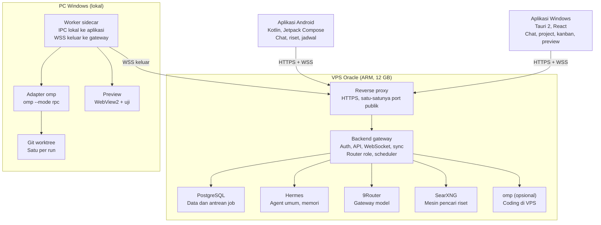

# System Architecture — Personal AI OS

Semua klien bicara ke satu backend gateway di VPS. Hanya pekerjaan yang menyentuh folder project dijalankan di PC Windows, lewat worker sidecar yang membuka koneksi keluar ke gateway.

## Diagram



Hermes, omp, dan research engine memanggil model hanya lewat 9Router. Port semua tools tetap di localhost VPS; yang publik hanya reverse proxy.

## Komponen

| Komponen | Lokasi | Tanggung jawab | Teknologi |
| --- | --- | --- | --- |
| Backend gateway | VPS | Auth, REST, WebSocket, pemilih agent dan skill, registri agent dan skill, orkestrasi run, scheduler, research engine, proxy model terautentikasi | Node 22, TypeScript, Fastify, Zod, Drizzle ORM, pg-boss |
| PostgreSQL 16 | VPS (Docker) | Sumber kebenaran: chat, run, kanban, jadwal, riset, log routing; antrean job | Postgres + pg-boss |
| Hermes | VPS | Agent umum, memori jangka panjang, tool web dan browse | API server kompatibel OpenAI di 127.0.0.1:8642 |
| 9Router | VPS | Semua panggilan model, fallback, kuota | 127.0.0.1:20128/v1 |
| SearXNG | VPS (Docker) | Pencarian web untuk deep research | 127.0.0.1:8888 |
| omp (opsional) | VPS | Role coding untuk repo yang di-clone di server | `omp --mode rpc` |
| Reverse proxy | VPS | TLS, port 443 satu-satunya yang publik | nginx yang sudah ada, ke gateway |
| Worker sidecar | PC Windows | WSS keluar ke gateway, menjalankan omp RPC, git worktree, dev server, Playwright, terminal | TypeScript, dikompilasi Bun menjadi .exe |
| Aplikasi Windows | PC Windows | UI desktop | Tauri 2, React 19, Vite, Tailwind CSS v4 |
| Aplikasi Android | HP | UI chat, riset, jadwal | Kotlin, Jetpack Compose, OkHttp, Room |

**Proxy model:** 9Router hanya mendengarkan di localhost, jadi gateway membuka endpoint `/llm/v1/*` yang meneruskan ke 9Router dengan token perangkat. omp di PC Windows memakai endpoint ini sebagai provider, sehingga semua API key tetap di VPS.

## Lokasi eksekusi

| Jenis tugas | Dijalankan di | Mesin |
| --- | --- | --- |
| Chat umum (Android dan Windows) | VPS | Hermes |
| Chat per folder dan kartu kanban | PC Windows | omp lewat worker |
| Deep research | VPS | Research engine di gateway + SearXNG |
| Jadwal | VPS | pg-boss, lalu Hermes atau research engine |
| Router role | VPS | Model kecil lewat 9Router |

## Kepemilikan data

- VPS adalah sumber kebenaran. Android menyimpan cache di Room, Windows di cache query dan SQLite milik worker.
- Isi file project tidak pernah disimpan di VPS. Yang keluar dari PC hanya konteks yang dikirim ke model, plus ringkasan run dan diff stat.
- Memori jangka panjang dipegang Hermes. Gateway menyimpan ID sesi Hermes per percakapan.

## Agent Adapter

Setiap mesin dibungkus satu adapter dengan antarmuka yang sama. UI tidak pernah tahu mesin mana yang berjalan.

```ts
export interface AgentAdapter {
  readonly id: 'hermes' | 'omp' | 'pi';
  capabilities(): AdapterCapabilities; // streaming, approvals, steer, checkpoints
  startRun(input: StartRunInput): Promise<RunHandle>;
}

export interface RunHandle {
  readonly runId: string;
  events: AsyncIterable<AgentEvent>; // format ternormalisasi, lihat API_CONTRACT.md
  steer(text: string): Promise<void>;
  cancel(): Promise<void>;
  resolveApproval(id: string, decision: 'allow' | 'deny', remember?: boolean): Promise<void>;
}
```

- **Adapter Hermes** (di gateway): HTTP streaming ke 127.0.0.1:8642. Role dan skill disuntik sebagai pesan sistem.
- **Adapter omp** (di worker): menjalankan `omp --mode rpc` dengan cwd = worktree, lalu membaca event dari stdio. Cara menyuntik role dan skill tanpa mengotori worktree diverifikasi di Fase 0. Fallback: role dikirim sebagai pesan sistem pertama lewat RPC.
- Versi setiap mesin dikunci. Perubahan protokol hanya boleh menyentuh adapter.

## Alur utama

1. **Chat umum:** klien kirim pesan, gateway memilih agent dan skill, adapter Hermes mengalirkan jawaban, event disimpan dan disiarkan lewat WebSocket.
2. **Run coding:** klien Windows membuat run, gateway menetapkan role, worker membuat worktree dan menjalankan omp, approval ditanyakan di aplikasi Windows, hasil berupa diff menunggu review.
3. **Deep research:** gateway membuat job, research engine merencanakan sub-pertanyaan, mencari lewat SearXNG, membaca halaman, lalu menyusun laporan bersitasi.
4. **Jadwal:** pg-boss memicu job sesuai cron, menjalankan prompt di Hermes atau research engine, menyimpan hasil, lalu mengirim notifikasi.

## Koneksi dan pemulihan

- Setiap event punya nomor urut per stream. Klien yang tersambung ulang mengirim `lastSeq`, lalu gateway memutar ulang event yang terlewat dari database.
- Heartbeat 20 detik. Reconnect otomatis dengan backoff 1 detik sampai 30 detik, tanpa langkah manual.
- Token akses diperbarui otomatis memakai refresh token perangkat.

## Struktur monorepo

```
personal-ai-os/
  apps/
    gateway/      # backend Fastify
    desktop/      # Tauri 2 + React
    worker/       # sidecar Windows (Bun)
    android/      # Kotlin + Compose (Gradle, di luar pnpm)
  packages/
    contracts/    # skema Zod, tipe event, OpenAPI
    ui-tokens/    # token desain JSON -> CSS vars dan Kotlin
    adapters/     # hermes, omp, pi
    roles/        # file role .md dan skills/
    config/       # eslint, tsconfig, prettier
  infra/
    compose/      # docker-compose VPS
    scripts/      # backup, deploy
  docs/
  AGENTS.md
```
